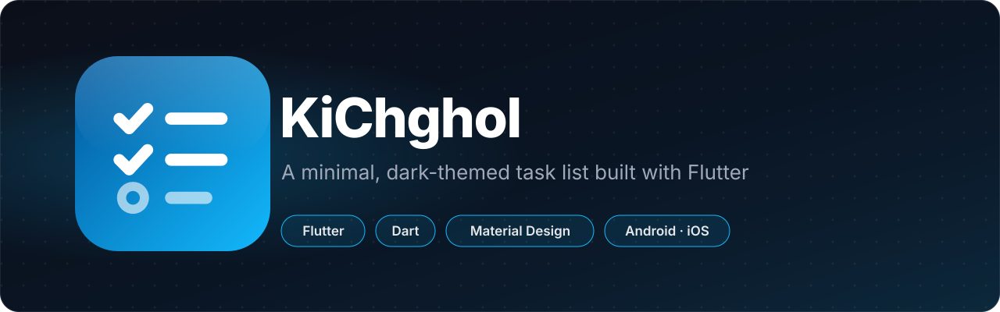
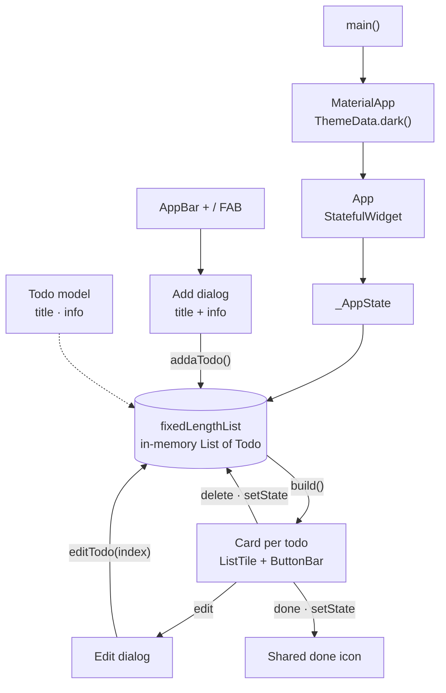

<div align="center">
  
  <p><b>A minimal, dark-themed Flutter task list: capture a todo with a title and a note, then edit, complete or clear it in a tap.</b></p>
  <p>
    
    
    
    <a href="LICENSE"></a>
    
    
    <a href="https://github.com/ismailbentabett/flutter-todo-app-ki-chghol/stargazers"></a>
    
  </p>
  <p><a href="#-quick-start">Quick start</a> · <a href="#-features">Features</a> · <a href="#-architecture">Architecture</a> · <a href="#-contributing">Contributing</a></p>
</div>

## Overview

**KiChghol** is a compact Flutter todo app built around a single screen: add a task with a title and a short note, then edit, mark or delete it from its card. It is a learning project and reference implementation of core Flutter building blocks: a `StatefulWidget` driving a list with `setState`, `AlertDialog` forms backed by `TextEditingController`s, and Material cards with inline actions.

> The name comes from Moroccan Darija: *"ki chghol"* loosely translates to "like stuff / things to do", a playful nod to what a todo list holds.

## ✨ Features

- **Quick capture** – add a todo from the app-bar `+` action or the centred floating action button; a dialog collects a *title* and an *info* note.
- **Inline editing** – the edit action on each card opens a dialog that overwrites that item's title and note.
- **One-tap delete** – remove any card instantly from the list.
- **Completion indicator** – a done action switches the check icon from `done` to `done_all`.
- **Card layout** – each todo renders as a Material `Card` with a `ListTile` (title + subtitle) and a `ButtonBar` of actions, inside a scrollable column.
- **Dark Material theme** – the whole app runs on `ThemeData.dark()`.
- **Mobile runners** – Android and iOS projects are included.

> [!NOTE]
> Todos live in memory only and reset when the app restarts, and the completion icon is a single shared state rather than per item. Both are tracked in the [roadmap](#-roadmap).

## 🧱 Tech stack

| Layer        | Technology                                              |
|--------------|---------------------------------------------------------|
| Framework    | Flutter (stable channel, 2020, pre-null-safety)         |
| Language     | Dart, SDK constraint `>=2.7.0 <3.0.0`                   |
| UI           | Material widgets, `ThemeData.dark()`                    |
| Icons        | Material Icons, `cupertino_icons ^0.1.3`                |
| State        | `StatefulWidget` + `setState`, in-memory `List<Todo>`   |
| Input        | `AlertDialog` + `TextField` + `TextEditingController`   |
| Platforms    | Android (`minSdkVersion 16`, `targetSdkVersion 28`), iOS |

## 🏗 Architecture



```
app/lib/
├── main.dart        # Entry point, theme, App widget, dialogs and list UI
└── todo_class.dart  # Todo model: title + info
```

## 🚀 Quick start

### Prerequisites

- [Flutter SDK](https://docs.flutter.dev/get-started/install) **1.20 – 2.x**. The project was created on Flutter 1.20 (stable), targets Dart `<3.0.0` without null safety and uses `FlatButton`, so it will not compile on Flutter 3.10+ / Dart 3 without migration. A version manager such as [FVM](https://fvm.app/) makes switching easy.
- An Android emulator or device, or an iOS simulator (macOS with Xcode).

### Run

The Flutter project lives in the `app/` subfolder.

```bash
git clone https://github.com/ismailbentabett/flutter-todo-app-ki-chghol.git
cd flutter-todo-app-ki-chghol/app
flutter pub get
flutter run
```

### Build

```bash
cd app
flutter build apk      # Android
flutter build ios      # iOS (macOS only)
```

## ⚙️ Configuration

No configuration is required. The app has no backend, no API keys and no environment variables; everything runs on-device.

## 📁 Project structure

```
flutter-todo-app-ki-chghol/
├── app/
│   ├── android/       # Android runner project (applicationId com.example.app)
│   ├── ios/           # iOS runner project
│   ├── lib/           # Application source (see Architecture)
│   └── pubspec.yaml   # Package manifest (package name: app)
├── .github/           # Branding assets, issue and PR templates
├── CONTRIBUTING.md
├── SECURITY.md
└── LICENSE
```

## 🗺 Roadmap

- [x] Add, edit and delete todos with a title and note
- [x] Dark Material UI with card-based list
- [ ] Track completion per todo (add a `done` field to `Todo`) instead of a shared icon state
- [ ] Persist todos locally (e.g. `shared_preferences` or SQLite)
- [ ] Pre-fill the edit dialog and clear the inputs after each add
- [ ] Migrate to sound null safety and Flutter 3 (replace `FlatButton` with `TextButton`)
- [ ] Widget tests for the add / edit / delete flow
- [ ] Give the package and application ID project-specific names

## 🤝 Contributing

Contributions are welcome. Please read [CONTRIBUTING.md](CONTRIBUTING.md) for the workflow, branch naming and commit conventions, and follow the [Code of Conduct](CODE_OF_CONDUCT.md).

## 🔒 Security

Please report vulnerabilities privately as described in [SECURITY.md](SECURITY.md). Do not open public issues for security problems.

## 📄 License

Released under the [MIT License](LICENSE).

---

<div align="center">
  <p>Built by <b>Ismail Bentabett</b> · <a href="https://github.com/ismailbentabett">GitHub</a> · <a href="https://ismailbentabett.com">ismailbentabett.com</a></p>
  <p>⭐ Star this repo if you find it useful</p>
</div>
